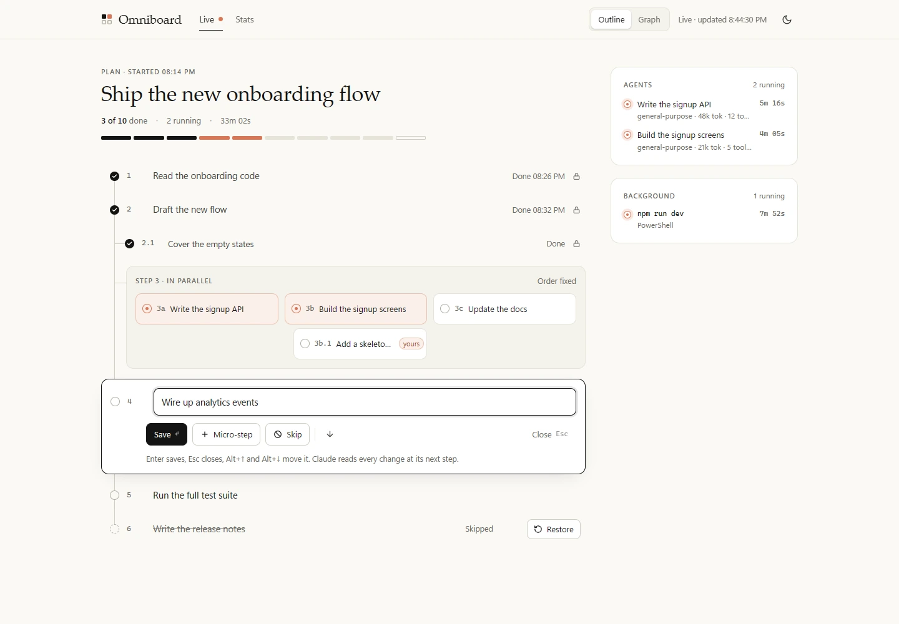
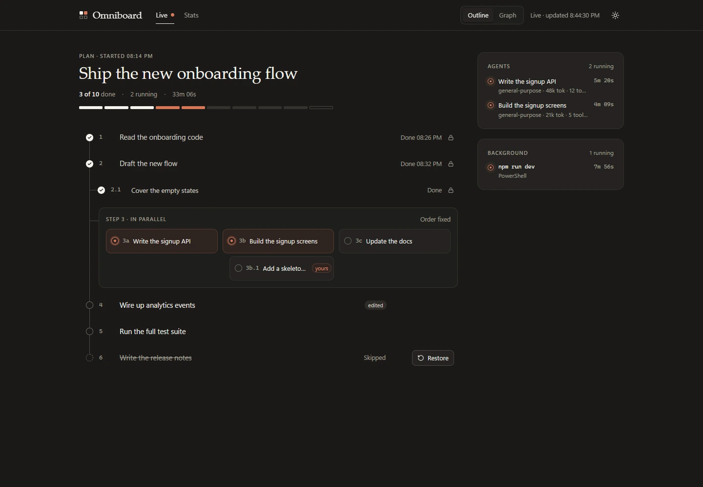
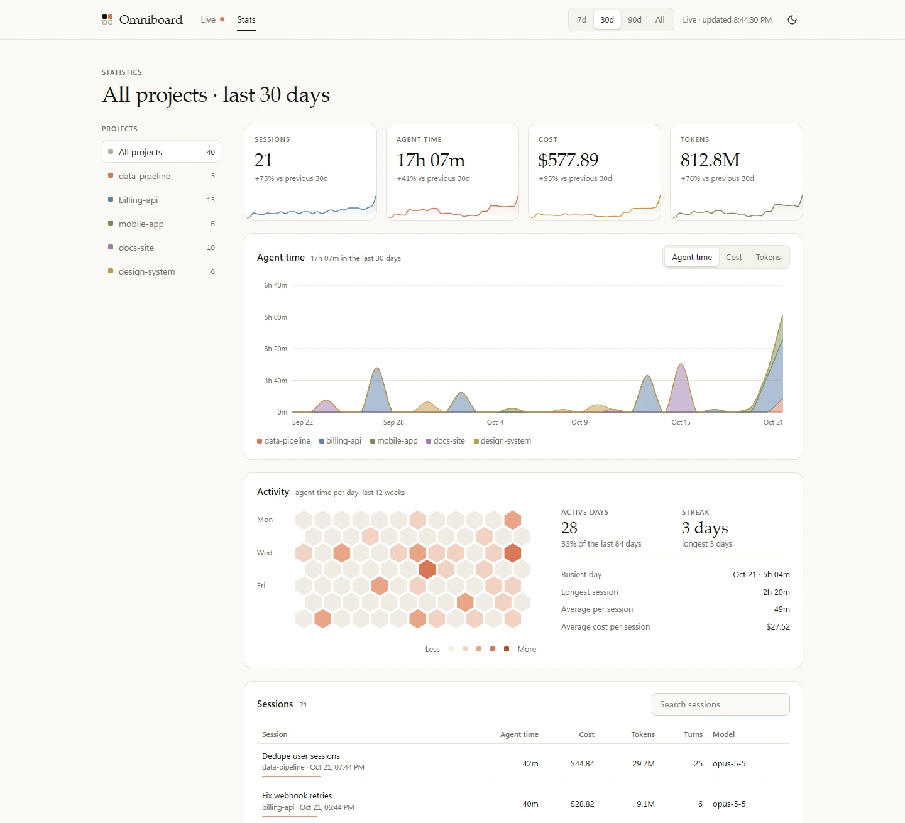

# omniboard — see where Claude is in its plan, and steer it

> The plan Claude is carrying out, live in a local board where you can edit it while Claude works (add micro-steps, rename, skip, reorder); its subagents and background tasks at a glance; your session statistics; and one row above the prompt with the progress.

[](LICENSE)
[](https://code.claude.com/docs/en/plugins)

Once you approve a plan, Claude goes off and works. You see tool calls scroll by, but not which step it is on, what is left, or what the three subagents it started are doing. `omniboard` puts that in one place, and lets you change the plan without stopping Claude.

## Install

```text
/plugin marketplace add GiuseppeBellamacina/cosmic-plugins
/plugin install omniboard@cosmic-plugins
```

Where `/plugin` isn't available (e.g. the VS Code extension), run these in a terminal, then `/reload-plugins` in the session:

```bash
claude plugin marketplace add GiuseppeBellamacina/cosmic-plugins
claude plugin install omniboard@cosmic-plugins
```

Requires a Claude Code build with plugin function hooks (mods) and [Node.js](https://nodejs.org) 18+ for the browser board and the import (standard library only, nothing to `npm install`).

## What you get

### A band above the prompt

One row, while a plan has open steps (one you approved, or steps Claude set for a longer task): the plan's progress, the session's cost, agent time and tokens, and **Omniboard**, which opens the browser board. With no plan running it does not show, and it steps aside while you type a slash command.

```text
▣ 3/7 ■■■□□□□□  │  $4.21 · 12m04s · 1.2M tok                     Omniboard
```

The steps, the subagents and the background tasks are in the board.

### `/board`: the browser board

A local page with two tabs, in a light and a dark theme (it follows your system; the button in the top bar switches it).







*The screenshots use made-up sample data.*

- **Live**: the plan as an outline. Click a step and it opens in place: rename it (Enter saves, Esc closes), add a micro-step, skip, restore, remove a step you added, move it (or Alt+↑ / Alt+↓, or drag its handle). A refused edit says why under the step it touched. Parallel steps sit in one block, and the one you open is edited at full width under it; finished steps carry a lock. **Stop plan**, beside the progress, ends the whole plan where it is (every open step skipped, the one in progress too); it asks for a second click. **Graph** in the top bar shows the same plan as a graph, top to bottom, with the editor under it. Beside the plan, only while there is something to show: the subagents and the background tasks running right now, and what you sent to Claude (*Waiting* until Claude reads it, then *Read*). It follows plans: while one has open steps it refreshes every second and a half (while the tab is visible); with none it rests, checks every 10 seconds for the next plan, and lets the board's server stop after 30 idle minutes.
- **Stats**: sessions, agent time, cost and tokens with sparklines and the change against the previous period; a chart per day stacked by project (Agent time / Cost / Tokens, 7d / 30d / 90d / All); every session in a searchable table; a 12-week activity map, active days, streak, busiest day, longest session and averages. The project list on the left filters everything.

### `/board-import`

Adds your past sessions to the statistics, from Claude Code's own transcripts (`~/.claude/projects`), plus the rows of ponytail's band ledger if you used it. Run it once; running it again only adds what is new.

### A plan outlives its session

Every change to the plan is also kept on disk, under the session it belongs to. Close a session halfway through a plan (you hit a usage limit, VS Code closed) and reopen it: the plan is back in the band and the board, and Claude is told with your next message to go on from the first open step.

### `/board-restore`

Carrying the work on in a **new** session instead: brings back the latest unfinished plan from another session, of the same project if there is one (else the most recent of any, and it says which), and Claude reads it with your next message. It leaves alone a session that already has an unfinished plan of its own, and says so. `/resume` inside an open session needs no command: the resumed session's plan comes back with your next message.

## How Claude keeps the plan current

- omniboard gives Claude a tool, `mcp__omniboard__plan`, whose description tells it when to use it: when it carries out an approved plan or any task of three steps or more, it sets the plan, then marks each step started and done. Steps it will run at the same time (subagents started together, say) go in as parallel steps, `2a`, `2b`, ... The tool never asks you for permission.
- When you approve a plan in plan mode, Claude is reminded to load it into omniboard before starting.
- **Claude can change the plan as the work demands**: insert a new step, add a micro-step, rename, skip, restore, remove or reorder steps, and stop the whole plan when you ask it to; the band and the board follow at once. The same locks apply to it as to you, and the steps you added or changed are yours: Claude has to ask you before renaming, skipping or removing them.
- **Your edits reach Claude for certain**: a short note ("The user changed your plan: added step 4.1 …") plus the updated plan is attached to the result of Claude's very next action, whatever tool it uses, or to your next prompt if it is idle. Claude reads it exactly once.
- **Claude cannot close the plan past your additions**: marking the last step done is refused while a step you added or changed is still open.
- **Finished work is locked**: once a step is done, its section can no longer be edited and gets no new micro-steps; nothing can be moved across work that has started. The board only offers what is allowed, and every edit is checked again when it is applied.

If Claude uses its own todo tool instead, omniboard mirrors it.

## Statistics: what the numbers mean

| Number | Live sessions | Imported sessions |
| --- | --- | --- |
| Cost | Claude Code's own session cost (what `/cost` shows) | Claude Code's cost record in the transcript |
| Tokens | Input, output and cache tokens of every turn, subagents included | Same, from the cost record |
| Agent time | Wall time of Claude's turns, from your prompt to its answer | Time spent in API calls and tools, from the cost record |
| Turns | Prompts you sent | Prompts you typed |

The two measures of agent time are close but not identical. A transcript without a cost record (rare, very old or empty sessions) is imported with tokens but no cost.

## Privacy and safety

- Everything stays on your machine, in `~/.claude/omniboard/` (`sessions.csv`, the ledger; `plans.json`, the 30 most recently changed plans; `live.json`, written only while the board is open). Delete the folder to start over.
- The board's server listens on `127.0.0.1` only, on a random port, behind a random token in the address. It accepts plan edits only from its own page, checks every edit, and stops with the session or after 30 minutes without requests. It never runs anything a page sends.

## Limits

- **Background tasks**: their end is taken from Claude Code's completion notices and from the stops Claude itself makes, so a task that ends without a notice can keep showing as running until the session ends.
- **Workflow subagents** are counted in the session's tokens but not listed one by one.
- **Parallel steps** move together: you can edit, skip or add micro-steps to each branch, but not reorder a branch on its own.
- **The browser board closes with the Claude Code session** that opened it; `/board` opens it again.

## License

[MIT](LICENSE)
